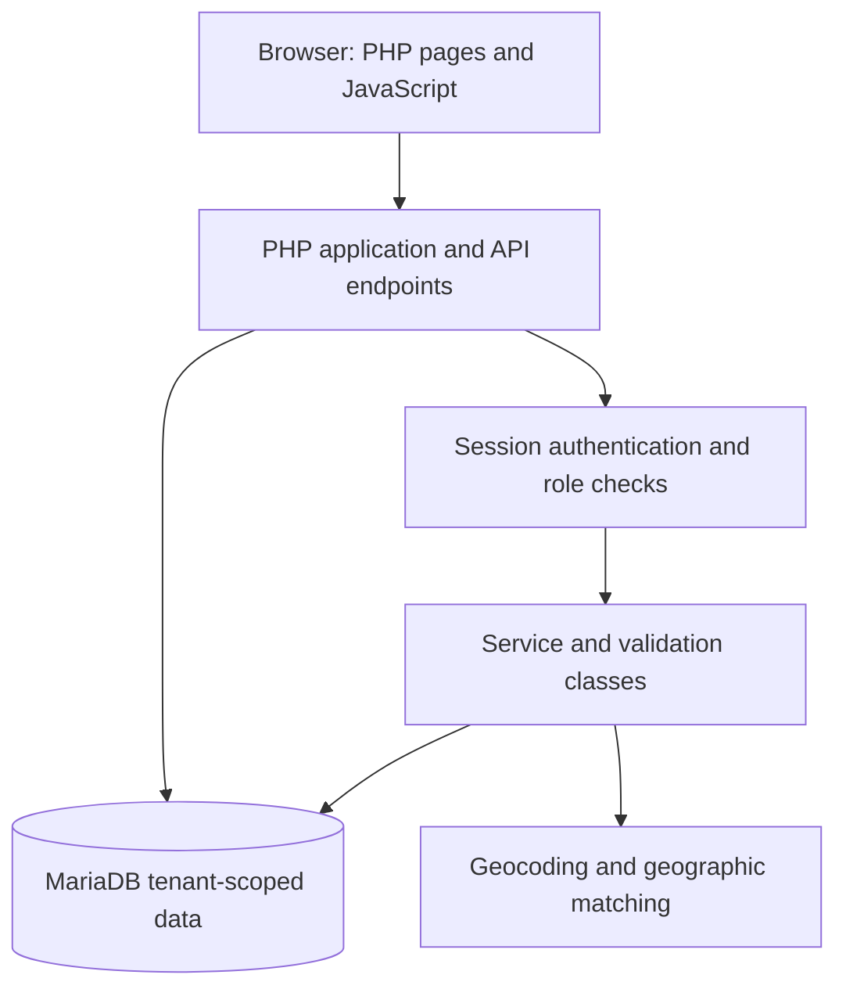

<div align="center">

# ✨ Brite Scheduler

### Multi-Tenant Scheduling, Service Operations & Contractor Marketplace

**Manage clients, service locations, appointments, contractor availability, qualifications, bids, and billing in one platform.**

`PHP` · `MariaDB` · `JavaScript` · `HTML/CSS` · `Multi-Tenant Architecture`

**Documentation version:** v1.0 · **Repository:** [qualitypro/britescheduler](https://github.com/qualitypro/britescheduler)

</div>

---

## 📚 Contents

- [📖 Overview](#-overview)
- [✨ Features](#-features)
- [👥 Roles and access](#-roles-and-access)
- [🏗️ Architecture](#️-architecture)
- [🧰 Technology stack](#-technology-stack)
- [🗂️ Repository structure](#️-repository-structure)
- [🗄️ Database and migrations](#️-database-and-migrations)
- [🔌 API overview](#-api-overview)
- [⚙️ Installation and configuration](#️-installation-and-configuration)
- [🔐 Security model](#-security-model)
- [🧪 Testing and validation](#-testing-and-validation)
- [🗺️ Roadmap](#️-roadmap)
- [🤝 Contributing and licensing](#-contributing-and-licensing)

## 📖 Overview

**Brite Scheduler** is a browser-based, multi-tenant service operations platform designed for organizations coordinating clients, contractors, appointments, and related financial workflows. It combines a scheduling workspace with contractor eligibility, geographic service coverage, and an appointment bidding marketplace.

A **tenant** represents a business or organization. Tenant-scoped data and role-based access help separate each organization's operational records. The server resolves tenant membership from the authenticated session rather than trusting a tenant identifier supplied by the browser.

> **Project scope:** This README describes functionality evidenced by the repository inventory and development work through commit `82085d7` (October 2026). Some features are still evolving; consult the implementation and test environment before relying on them in production.

## ✨ Features

### 📅 Scheduling and appointments

- Calendar and appointment management for service operations.
- Client appointment booking and available-slot lookup.
- Contractor availability, assignment validation, and conflict checks.
- Appointment-to-client-service-location relationships.
- Booking request idempotency to reduce accidental duplicate submissions.
- Client and contractor dashboards tailored to their workflows.

### 🛠️ Contractor management

- Contractor records, profiles, and skills.
- Contractor service qualifications with review and verification states.
- Per-contractor, per-service **hourly** or **flat-rate** pricing.
- Contractor availability and geographic service-area configuration.
- Eligibility, matching, and ranking components supporting contractor selection.

> **Qualification terminology:** A platform-verified service qualification records a tenant-authorized review. It does **not** independently certify a professional license or regulatory compliance.

### 🤝 Marketplace and bidding

- Appointment bid listings and contractor bid submissions.
- Owner/admin bid review and award workflows.
- Contractor-facing marketplace and bid management.
- Client-facing **My Marketplace Requests** and eligible bid visibility.
- Contractor profile links from eligible bids and assigned appointments.
- Profile display of business information, skills, and applicable service qualifications.
- Relationship- and tenant-scoped access controls for client profile viewing.

### 📍 Client locations and geographic intelligence

- Multiple saved client service locations and primary-location selection.
- Appointment association with saved client locations.
- Geocoding cache, status tracking, and retry diagnostics.
- Contractor service areas based on postal codes or geographic radius.
- Service-location map views and service-area matching components.

### 💼 Business operations and billing

- Tenant business profile and business contact information.
- Client, contractor, and service catalog management.
- Invoices and payment ledger workflows.
- Notifications and appointment-linked activity.
- Persistent user interface preferences, including calendar settings and accessibility options.

> **Payments:** The included payment functionality is an **accounting ledger**, not a PCI-compliant card processor. Do not store payment card numbers, CVV values, or card credentials. Any future card payment integration should use a compliant hosted checkout or tokenization provider and retain only appropriate provider references.

## 👥 Roles and access

Tenant membership determines a user's role. The application defines these roles:

| Role | General responsibility |
| --- | --- |
| **Owner** | Business administration, operations, Marketplace review, and award decisions |
| **Admin** | Administrative management and authorized Marketplace oversight |
| **Scheduler** | Scheduling and operational coordination |
| **Accounting** | Billing and finance-related workflows |
| **Contractor** | Availability, service offerings, Marketplace participation, and assigned work |
| **Client** | Service locations, booking requests, own appointments, and eligible Marketplace activity |

**Permissions are endpoint-specific.** This table describes broad responsibilities, not a guarantee of access to every screen or API.

## 🏗️ Architecture



The application uses server-rendered PHP entry points, JavaScript for interactive workflows, PHP API endpoints, and a MariaDB relational database. Core application classes cover authentication, database access, CSRF handling, scheduling validation, contractor eligibility, ranking, service-area matching, and geocoding.

### Core design principles

1. **Tenant isolation:** business records carry tenant context; authorization resolves tenant membership server-side.
2. **Role-based authorization:** protected endpoints verify authenticated users and applicable tenant roles.
3. **Relational integrity:** migrations add foreign keys, unique constraints, and tenant-aware relationships.
4. **Separation of responsibilities:** UI pages, API endpoints, and domain logic are organized in distinct directories.
5. **Incremental schema evolution:** numbered SQL migrations track database changes.

## 🧰 Technology stack

| Layer | Technology |
| --- | --- |
| Backend | PHP |
| Database | MariaDB / MySQL-compatible SQL |
| Frontend | HTML, CSS, JavaScript |
| Authentication | PHP sessions and tenant membership |
| API | PHP HTTP endpoints, primarily JSON responses |
| Database evolution | Numbered SQL migration files |
| Development environment used by the project | Fedora Linux with a local Apache/PHP/MariaDB stack |

**Version note:** Migration `011_contractor_service_qualifications.sql` explicitly requires **MariaDB 10.4+**. A complete supported PHP/browser/version matrix has not yet been verified.

## 🗂️ Repository structure

```text
britescheduler/
├── api/                 # Authentication and domain API endpoints
│   └── auth/            # Sign-in, sign-out, registration
├── app/                 # Shared PHP services, validation, authorization
├── assets/              # JavaScript and other frontend assets
├── docs/                # Additional project documentation
├── events/              # Legacy event-related files
├── migrations/          # Ordered SQL schema migrations
├── partials/            # Shared application layout components
├── setup/               # Initial owner/bootstrap utilities
├── .env.example         # Environment variable template
├── README-BRITE-V2.md   # Earlier architecture/setup notes
├── bidding.php          # Marketplace interface
├── scheduling.php       # Scheduling interface
├── client-dashboard.php # Client workspace
└── contractor-dashboard.php # Contractor workspace
```

Other root-level pages provide billing, service locations, contractor service areas, preferences, and administrative workflows. Refer to the tracked source tree for the complete inventory.

## 🗄️ Database and migrations

The schema uses a `tenants` table, user records, tenant memberships, clients, contractors, services, appointments, and related operational records. Recent migrations introduce additional functionality:

| Migration | Purpose |
| --- | --- |
| `001_core.sql` | Core schema and migration tracking |
| `002_legacy_events_import.sql` | Legacy import compatibility marker; **does not import automatically** |
| `003_invoice_appointment_unique.sql` | Invoice/appointment uniqueness |
| `004_tenant_business_profile.sql` | Tenant business details |
| `005`–`007` | Client locations, integrity, appointment location links |
| `008`–`009` | Geocoding cache and location status |
| `010` | Contractor geographic service areas |
| `011` | Contractor service qualifications |
| `012` | Client booking request idempotency |
| `013` | Notification-to-appointment references |
| `014`–`015` | User preferences and high-contrast defaults |
| `016` | Contractor service pricing |
| `017` | Appointment bidding marketplace |

**Apply migrations in numeric order** using the project's supported migration workflow. Do not assume all migrations are safe to re-run on an existing database; back up the database first and check the migration history.

**Legacy events:** Older event records are **not automatically imported**. Their original user IDs may not safely map to current tenant memberships. Export, review, and map records to the correct tenant/client/contractor before any manual import.

## 🔌 API overview

The `api/` directory groups HTTP endpoints by capability:

| Domain | Representative endpoints |
| --- | --- |
| Authentication | `api/auth/login.php`, `logout.php`, `register.php` |
| Appointments | `api/appointments.php`, `client_bookings.php`, `client_available_slots.php` |
| Marketplace | `appointment_bid_listings.php`, `contractor_bids.php`, `appointment_bid_award.php`, `appointment_bid_activity.php` |
| Client Marketplace | `marketplace_client_listings.php`, `marketplace_contractor_profile.php` |
| Contractors | `contractors.php`, `contractor_availability.php`, `contractor_service_pricing.php`, `contractor_service_qualifications.php` |
| Geographic services | `client_locations.php`, `contractor_service_areas.php`, `service_locations_map.php` |
| Finance | `invoices.php`, `payments.php` |
| Notifications | `user_notifications.php`, `user_notification_read.php`, `owner_notifications.php` |
| Preferences | `user_preferences.php` |

This is a **directory guide, not a complete public API contract**. HTTP methods, request bodies, response schemas, and permissions should be checked in each endpoint before integration. Authentication is session-based; do not assume these are anonymous/public APIs.

## ⚙️ Installation and configuration

### Prerequisites

- A web server capable of running PHP (the project has been developed using a local Apache/PHP stack).
- MariaDB **10.4+** for the qualification schema.
- Database credentials for a dedicated, least-privileged application account.
- A PHP environment with the extensions required by the source code (extension inventory still to be verified).

### Initial configuration

1. Clone the repository and configure the web server document root/path for the application.
2. Copy `.env.example` to `.env` and configure the local environment. **Never commit `.env` or secrets.**
3. Create the application database and a **non-root** database account with appropriate privileges.
4. Apply the SQL migrations in ascending numeric order using the project wizard's `--migrate` workflow or a reviewed manual migration process.
5. Create the initial tenant owner using the existing setup command below, substituting your own values:

```bash
BRITE_ADMIN_PASSWORD='replace-with-a-long-unique-password' \
  php setup/create_admin.php acme "Acme LLC" owner@example.com First Last
```

6. If using the legacy setup wizard, review its `--activate` option before enabling the v2 pages.
7. Confirm sign-in, tenant membership, and permissions using non-production test accounts.

> **Important:** The precise wizard invocation, required PHP extensions, deployment configuration, and migration runner behavior need source-level verification before this section can be treated as a production installation guide. Do not run schema changes against live data without a tested backup and rollback plan.

### Environment variables

The tracked `.env.example` documents these configuration names:

| Variable | Purpose |
| --- | --- |
| `APP_ENV` | Application environment |
| `APP_URL` | Base application URL |
| `APP_TIMEZONE` | Application timezone |
| `SESSION_NAME` | Session cookie name |
| `DB_HOST` | Database hostname |
| `DB_PORT` | Database port |
| `DB_NAME` | Database name |
| `DB_USER` | Database username |
| `DB_PASS` | Database password |

Geocoding and initial-admin settings may be referenced by additional PHP environment lookups; check the implementation before deployment.

## 🔐 Security model

- Session-based authentication and tenant-membership role checks.
- Server-side tenant resolution rather than trusting client-provided tenant identifiers.
- Tenant-scoped SQL relationships and authorization checks.
- CSRF support through the application's `Csrf` component.
- Relationship-scoped contractor profile visibility for clients.
- Restricted bid visibility for eligible statuses, excluding withdrawn bids.
- No storage of payment-card credentials in the accounting ledger.

**Security disclaimer:** Architectural safeguards and passing development tests are not substitutes for a full production security assessment. Review session settings, HTTPS, secrets management, deployment hardening, and access-control coverage before public deployment.

## 🧪 Testing and validation

Development verification has included PHP syntax checks, Git diff/merge checks, browser integration checks, and authorization regression tests. In the Marketplace development cycle, an existing-fixture regression passed **11/11 checks** covering authorized client profile access, unauthorized client/tenant access, and eligible bid visibility.

**Known testing gap:** Dedicated negative fixture tests for a *rejected-bid-only* relationship and a *declined-assignment-only* relationship remain outstanding. These authorization conditions are restricted in the implementation, but should be explicitly tested before treating the coverage as complete.

A formal automated test runner, CI configuration, and reproducible full-suite command have not been established by the available documentation.

## 🗺️ Roadmap

The following are **planned or potential improvements**, not claims of completed functionality:

- Broader end-to-end tests and reproducible CI checks.
- Additional negative authorization fixtures for Marketplace access.
- Further contractor discovery and geographic matching improvements.
- Expanded map-based workflows and proximity filtering.
- Hardened deployment and operations documentation.
- Formal API contracts and versioned integration guidance.
- Payment processor integration through a PCI-compliant hosted/tokenized flow, if required.

## 🤝 Contributing and licensing

This project is under active development. Before contributing, review existing conventions, keep tenant isolation intact, validate PHP syntax, and test role-based access to modified endpoints. Avoid committing credentials, local environment files, backups, or generated debug artifacts.

**License:** No license file was identified in the repository audit. Until the project owner selects and publishes a license, **do not assume the repository is open-source licensed** merely because the code is publicly accessible.

---

<div align="center">

**Brite Scheduler** · Scheduling, service operations, and contractor marketplace

*README v1.0 — approved October 2026*

</div>
