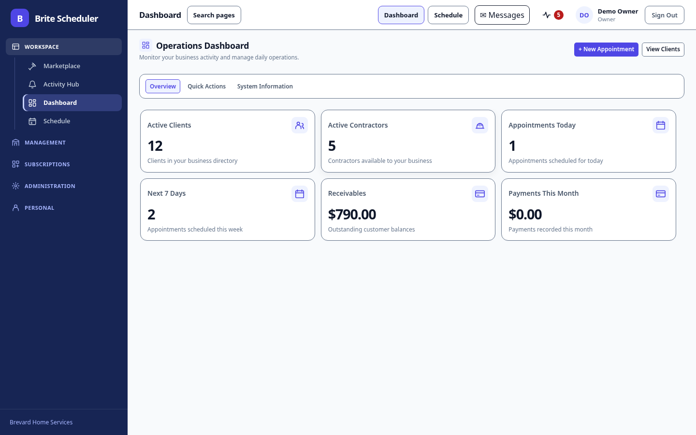
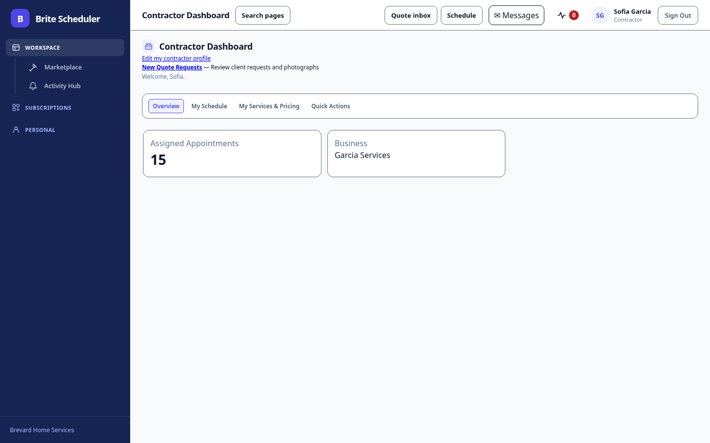
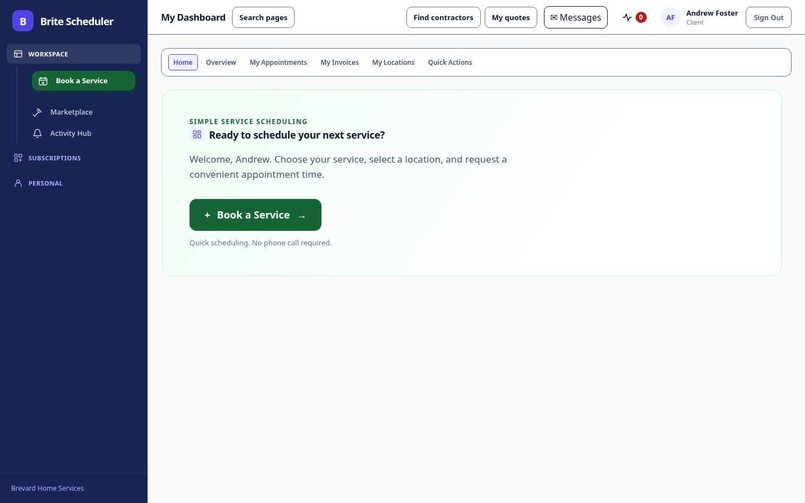
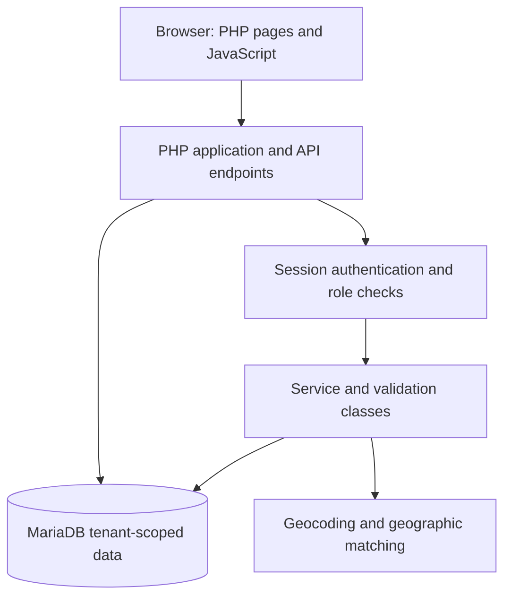

<div align="center">

# ✨ Brite Scheduler

### Multi-Tenant Scheduling, Service Operations & Contractor Marketplace

**Manage clients, service locations, appointments, contractor availability, qualifications, bids, and billing in one platform.**

`PHP` · `MariaDB` · `JavaScript` · `HTML/CSS` · `Multi-Tenant Architecture`

**Documentation version:** v1.2 · **Repository:** [qualitypro/britescheduler](https://github.com/qualitypro/britescheduler)

</div>

---

## 📸 Application screenshots

**[Open the live interactive screenshot gallery](https://qualitypro.github.io/britescheduler/)** — 87 published screenshots across Owner, Contractor, and Client workspaces, with desktop, tablet, and mobile previews, role filters, and full-screen image inspection.

| Owner workspace | Contractor workspace | Client workspace |
| --- | --- | --- |
| [](https://qualitypro.github.io/britescheduler/) | [](https://qualitypro.github.io/britescheduler/) | [](https://qualitypro.github.io/britescheduler/) |
| [View all Owner screenshots](https://qualitypro.github.io/britescheduler/) | [View all Contractor screenshots](https://qualitypro.github.io/britescheduler/) | [View all Client screenshots](https://qualitypro.github.io/britescheduler/) |

The published gallery also includes scheduling, Marketplace, CRM, locations, billing, messaging, and other available role-specific screens. For capture and publication instructions, see [Screenshot Gallery documentation](qa/screenshots/PUBLIC_GALLERY.md).

---

## 📚 Contents

- [📖 Overview](#-overview)
- [✨ Features](#-features)
- [👥 Roles and access](#-roles-and-access)
- [🏗️ Architecture](#️-architecture)
- [🧰 Technology stack](#-technology-stack)
- [🗂️ Repository structure](#️-repository-structure)
- [🗄️ Database and migrations](#️-database-and-migrations)
- [🔌 API overview](#-api-overview)
- [⚙️ Installation and configuration](#️-installation-and-configuration)
- [🔐 Security model](#-security-model)
- [🧪 Testing and validation](#-testing-and-validation)
- [🗺️ Roadmap](#️-roadmap)
- [🤝 Contributing and licensing](#-contributing-and-licensing)

## 📖 Overview

**Brite Scheduler** is a browser-based, multi-tenant service operations platform designed for organizations coordinating clients, contractors, appointments, and related financial workflows. It combines a scheduling workspace with contractor eligibility, geographic service coverage, and an appointment bidding marketplace.

A **tenant** represents a business or organization. Tenant-scoped data and role-based access help separate each organization's operational records. The server resolves tenant membership from the authenticated session rather than trusting a tenant identifier supplied by the browser.

> **Project scope:** This README reflects reviewed implementation files on `main` as of November 3, 2026, including the recent UI, Activity Hub, and Trends changes. Feature descriptions refer to source implementation, not a production certification. Some workflows still require authenticated browser and regression testing.

## ✨ Features

### 📅 Scheduling and appointments

- Calendar and appointment management for service operations.
- Client appointment booking and available-slot lookup.
- Contractor availability, assignment validation, and conflict checks.
- Appointment-to-client-service-location relationships.
- Booking request idempotency to reduce accidental duplicate submissions.
- Client and contractor dashboards tailored to their workflows.

### 🪪 Cycle 71A — Contractor profile builder

Contractors can edit their own professional headline, biography, specialties, years of experience, and HTTPS portfolio URL from `contractor-profile.php` (linked from the contractor dashboard). The `api/my_contractor_profile.php` GET/PUT endpoint resolves the active contractor from the authenticated tenant/user session, validates inputs, and requires CSRF protection for updates. No user-supplied contractor ID is accepted for profile edits.

Apply **`migrations/020_contractor_profiles.sql` once** before opening the editor. It adds a separate tenant-scoped profile table without changing existing contractor rows. The existing `api/marketplace_contractor_profile.php` adds these fields only **after** its existing appointment/bid/assignment authorization check; email and phone remain excluded. The initial release uses the existing account identity, not image uploads.

**Validation status:** PHP and JavaScript syntax checks have been added to the source smoke workflow. Authenticated multi-tenant browser/API testing and migration execution on the local MariaDB instance remain outstanding.

### 🛠️ Contractor management

- Contractor records, profiles, and skills.
- Contractor service qualifications with review and verification states.
- Per-contractor, per-service **hourly** or **flat-rate** pricing.
- Contractor availability and geographic service-area configuration.
- Eligibility, matching, and ranking components supporting contractor selection.

> **Qualification terminology:** A platform-verified service qualification records a tenant-authorized review. It does **not** independently certify a professional license or regulatory compliance.

### 🧭 Smart Dispatch (Cycles 69A–69D)

The scheduling wizard includes **read-only, advisory contractor recommendations** for owner, admin, and scheduler roles. The recommendation API (`api/contractor_recommendations.php`) requires a tenant-owned saved client location and valid appointment interval; an active service can be supplied to evaluate qualifications and offerings.

- **69A — Service offering and pricing:** show whether a contractor offers the selected service and their configured hourly or flat rate. A missing offering is advisory and is not itself a new assignment prohibition.
- **69B — Explainable eligibility and geography:** display ZIP/radius matches, straight-line distance from a configured radius center, availability/conflict information, and qualification/service-offering review issues.
- **69C — Interactive filters:** filter recommendations by dispatch status, verified qualification, confirmed service offering, availability, and a maximum numeric rate. Filtering runs in the browser against the returned recommendation set and does **not** modify ranking or assignment eligibility. Hourly and flat-rate amounts are not directly comparable appointment estimates.
- **69D — Appointment review integration:** show selected contractors in the final wizard step and request fresh advisory recommendations before save. Review warnings and failed refreshes require explicit user confirmation to continue; the existing scheduling conflict check and appointment API validation still apply. Saving an appointment with no contractor selected remains supported.

**Important distinctions:** The eligibility engine only recommends active contractors with a matching configured service area; Marketplace bidding has separate rules and can include contractors outside normal coverage/availability. A recommendation score is **not** authorization to assign. The ranking uses qualification (up to 35 points), availability/conflicts (30), geographic match (20), and workload (up to 15). Geographic distance is straight-line, not travel distance. The recommendation endpoint never auto-assigns contractors.

**Validation status:** Cycles 69A–69D have passed local source checks (PHP lint and source presence/merge verification). These checks do not establish authenticated browser, end-to-end, or security regression coverage; those are planned for Cycle 70.

### 🤝 Marketplace and bidding

- Appointment bid listings and contractor bid submissions.
- Owner/admin bid review and award workflows.
- Contractor-facing marketplace and bid management.
- Client-facing **My Marketplace Requests** and eligible bid visibility.
- Contractor profile links from eligible bids and assigned appointments.
- Profile display of business information, skills, and applicable service qualifications.
- Relationship- and tenant-scoped access controls for client profile viewing.

### 📍 Client locations and geographic intelligence

- Multiple saved client service locations and primary-location selection.
- Appointment association with saved client locations.
- Geocoding cache, status tracking, and retry diagnostics.
- Contractor service areas based on postal codes or geographic radius.
- Service-location map views and service-area matching components.

### 🖥️ Application shell, directories, and accessibility

- Shared role-aware application header and sidebar, with a **notification indicator beside the signed-in user details** instead of a bottom-corner floating Activity Hub bubble.
- **Activity Hub drawer** with outstanding/all views, unread counts, dismissal controls, and appointment review links where supported by the notification type. The full Activity Hub page remains available.
- **Contextual tooltips** for navigation links, buttons, sorting controls, and expandable details, shown on pointer hover or keyboard focus. Known actions have specific descriptions; other labeled controls use generated fallbacks. These have not been individually audited across every page.
- **Progressive value pills** summarize selected or entered form values while preserving the underlying controls and submissions. Users can reopen the editor; screens can opt out using `data-brite-pills="off"`. Dropdown labels exclude their option lists.
- **Sortable, paginated lists** and expandable directory records where supported. The Contractors directory exposes Contractor, Created On, Last Edited, and Status sortable headings, with Status last. The Clients directory includes client name, email, created/edited timestamps, and status.
- Persisted UI preferences include palette, calendar view, week start, time format, reduced motion, high contrast, and in-app notifications. Migration `015` defaults new high-contrast preference records to enabled without overriding existing preferences.

### 📈 Booking and scheduling trends

The `trends.php` workspace and `api/trends.php` provide a **rolling three-month window** (previous, selected, and following month) with appointment-status filtering, daily/weekly/monthly aggregation, and line/bar chart views.

- Selectable series: appointments, booking requests, assigned/unassigned appointments, accepted/declined contractor assignments, and **Gross Booked Value (USD)**.
- Gross Booked Value is recalculated from the **union of selected appointment categories** using server-provided per-day membership masks; appointments shared by several categories contribute only once.
- The **Appointments** checkbox represents the all-bookings baseline and is mutually exclusive with narrower appointment categories. The Gross Booked Value checkbox controls chart visibility; its summary metric remains visible.
- Booked value uses non-void linked invoice totals where available, otherwise catalog service prices. Cancelled and no-show appointments contribute no booked value. **This is an estimate/booking metric, not collected cash or recognized revenue.**
- Assignment decision counts reflect current assignment states on the appointment's service date, not historical decision timestamps.

**Validation caveat:** Source implementation and syntax checks do not establish that every revenue filter combination has been reconciled against a live tenant database. Verify selected-series totals and overlapping-category deduplication with representative fixtures before using these figures for financial decisions.

### 💼 Business operations and billing

- Tenant business profile and business contact information.
- Client, contractor, and service catalog management.
- Invoices and payment ledger workflows.
- Notifications and appointment-linked activity.
- Persistent user interface preferences, including calendar settings and accessibility options.

> **Payments:** The included payment functionality is an **accounting ledger**, not a PCI-compliant card processor. Do not store payment card numbers, CVV values, or card credentials. Any future card payment integration should use a compliant hosted checkout or tokenization provider and retain only appropriate provider references.

## 👥 Roles and access

Tenant membership determines a user's role. The application defines these roles:

| Role | General responsibility |
| --- | --- |
| **Owner** | Business administration, operations, Marketplace review, and award decisions |
| **Admin** | Administrative management and authorized Marketplace oversight |
| **Scheduler** | Scheduling and operational coordination |
| **Accounting** | Billing and finance-related workflows |
| **Contractor** | Availability, service offerings, Marketplace participation, and assigned work |
| **Client** | Service locations, booking requests, own appointments, and eligible Marketplace activity |

**Permissions are endpoint-specific.** This table describes broad responsibilities, not a guarantee of access to every screen or API.

## 🏗️ Architecture



The application uses server-rendered PHP entry points, JavaScript for interactive workflows, PHP API endpoints, and a MariaDB relational database. Core application classes cover authentication, database access, CSRF handling, scheduling validation, contractor eligibility, ranking, service-area matching, and geocoding.

### Core design principles

1. **Tenant isolation:** business records carry tenant context; authorization resolves tenant membership server-side.
2. **Role-based authorization:** protected endpoints verify authenticated users and applicable tenant roles.
3. **Relational integrity:** migrations add foreign keys, unique constraints, and tenant-aware relationships.
4. **Separation of responsibilities:** UI pages, API endpoints, and domain logic are organized in distinct directories.
5. **Incremental schema evolution:** numbered SQL migrations track database changes.

## 🧰 Technology stack

| Layer | Technology |
| --- | --- |
| Backend | PHP |
| Database | MariaDB / MySQL-compatible SQL |
| Frontend | HTML, CSS, JavaScript |
| Authentication | PHP sessions and tenant membership |
| API | PHP HTTP endpoints, primarily JSON responses |
| Database evolution | Numbered SQL migration files |
| Development environment used by the project | Fedora Linux with a local Apache/PHP/MariaDB stack |

**Version note:** Migration `011_contractor_service_qualifications.sql` explicitly requires **MariaDB 10.4+**. A complete supported PHP/browser/version matrix has not yet been verified.

## 🗂️ Repository structure

```text
britescheduler/
├── api/                 # Authentication and domain API endpoints
│   └── auth/            # Sign-in, sign-out, registration
├── app/                 # Shared PHP services, validation, authorization
├── assets/              # JavaScript and other frontend assets
├── docs/                # Additional project documentation
├── events/              # Legacy event-related files
├── migrations/          # Ordered SQL schema migrations
├── partials/            # Shared application layout components
├── setup/               # Initial owner/bootstrap utilities
├── .env.example         # Environment variable template
├── README-BRITE-V2.md   # Earlier architecture/setup notes
├── trends.php           # Booking/scheduling charts and booked value
├── activity-hub.php     # Full notification activity view
├── contractors.v2.php   # Contractor directory and qualifications
├── contractor-service-areas.php # ZIP/radius coverage and matching
├── bidding.php          # Marketplace interface
├── scheduling.php       # Scheduling interface
├── client-dashboard.php # Client workspace
└── contractor-dashboard.php # Contractor workspace
```

Other root-level pages provide billing, service locations, contractor service areas, preferences, and administrative workflows. Refer to the tracked source tree for the complete inventory.

## 🗄️ Database and migrations

The schema uses a `tenants` table, user records, tenant memberships, clients, contractors, services, appointments, and related operational records. Recent migrations introduce additional functionality:

| Migration | Purpose |
| --- | --- |
| `001_core.sql` | Core schema and migration tracking |
| `002_legacy_events_import.sql` | Legacy import compatibility marker; **does not import automatically** |
| `003_invoice_appointment_unique.sql` | Invoice/appointment uniqueness |
| `004_tenant_business_profile.sql` | Tenant business details |
| `005`–`007` | Client locations, integrity, appointment location links |
| `008`–`009` | Geocoding cache and location status |
| `010` | Contractor geographic service areas |
| `011` | Contractor service qualifications |
| `012` | Client booking request idempotency |
| `013` | Notification-to-appointment references |
| `014`–`015` | User preferences and high-contrast defaults |
| `016` | Contractor service pricing |
| `017` | Appointment bidding marketplace |
| `018` | Additional schema changes; inspect the actual migration before applying |
| `019_contractor_service_offerings.sql` | Tenant-scoped contractor service offerings and hourly/flat-rate pricing |

**Apply migrations in numeric order** using the project's supported migration workflow. Do not assume all migrations are safe to re-run on an existing database; back up the database first and check the migration history.

**Legacy events:** Older event records are **not automatically imported**. Their original user IDs may not safely map to current tenant memberships. Export, review, and map records to the correct tenant/client/contractor before any manual import.

## 🔌 API overview

The `api/` directory groups HTTP endpoints by capability:

| Domain | Representative endpoints |
| --- | --- |
| Authentication | `api/auth/login.php`, `logout.php`, `register.php` |
| Appointments | `api/appointments.php`, `client_bookings.php`, `client_available_slots.php` |
| Marketplace | `appointment_bid_listings.php`, `contractor_bids.php`, `appointment_bid_award.php`, `appointment_bid_activity.php` |
| Client Marketplace | `marketplace_client_listings.php`, `marketplace_contractor_profile.php` |
| Contractors | `contractors.php`, `contractor_availability.php`, `contractor_service_pricing.php`, `contractor_service_qualifications.php`, `contractor_service_offerings.php` |
| Smart Dispatch | `contractor_recommendations.php`, `contractor_conflict_check.php` |
| Geographic services | `client_locations.php`, `contractor_service_areas.php`, `service_locations_map.php` |
| Finance | `invoices.php`, `payments.php` |
| Notifications | `user_notifications.php`, `user_notification_read.php`, `owner_notifications.php` |
| Preferences | `user_preferences.php` |
| Trends | `trends.php` (rolling booking/assignment series and revenue membership masks) |

This is a **directory guide, not a complete public API contract**. HTTP methods, request bodies, response schemas, and permissions should be checked in each endpoint before integration. Authentication is session-based; do not assume these are anonymous/public APIs.

## ⚙️ Installation and configuration

### Prerequisites

- A web server capable of running PHP (the project has been developed using a local Apache/PHP stack).
- MariaDB **10.4+** for the qualification schema.
- Database credentials for a dedicated, least-privileged application account.
- A PHP environment with the extensions required by the source code (extension inventory still to be verified).

### Initial configuration

1. Clone the repository and configure the web server document root/path for the application.
2. Copy `.env.example` to `.env` and configure the local environment. **Never commit `.env` or secrets.**
3. Create the application database and a **non-root** database account with appropriate privileges.
4. Apply the SQL migrations in ascending numeric order using the project wizard's `--migrate` workflow or a reviewed manual migration process.
5. Create the initial tenant owner using the existing setup command below, substituting your own values:

```bash
BRITE_ADMIN_PASSWORD='replace-with-a-long-unique-password' \
  php setup/create_admin.php acme "Acme LLC" owner@example.com First Last
```

6. If using the legacy setup wizard, review its `--activate` option before enabling the v2 pages.
7. Confirm sign-in, tenant membership, and permissions using non-production test accounts.

> **Important:** The precise wizard invocation, required PHP extensions, deployment configuration, and migration runner behavior need source-level verification before this section can be treated as a production installation guide. Do not run schema changes against live data without a tested backup and rollback plan.

### Environment variables

The tracked `.env.example` documents these configuration names:

| Variable | Purpose |
| --- | --- |
| `APP_ENV` | Application environment |
| `APP_URL` | Base application URL |
| `APP_TIMEZONE` | Application timezone |
| `SESSION_NAME` | Session cookie name |
| `DB_HOST` | Database hostname |
| `DB_PORT` | Database port |
| `DB_NAME` | Database name |
| `DB_USER` | Database username |
| `DB_PASS` | Database password |

Geocoding and initial-admin settings may be referenced by additional PHP environment lookups; check the implementation before deployment.

## 🔐 Security model

- Session-based authentication and tenant-membership role checks.
- Server-side tenant resolution rather than trusting client-provided tenant identifiers.
- Tenant-scoped SQL relationships and authorization checks.
- CSRF support through the application's `Csrf` component.
- Relationship-scoped contractor profile visibility for clients.
- Restricted bid visibility for eligible statuses, excluding withdrawn bids.
- No storage of payment-card credentials in the accounting ledger.

**Security disclaimer:** Architectural safeguards and passing development tests are not substitutes for a full production security assessment. Review session settings, HTTPS, secrets management, deployment hardening, and access-control coverage before public deployment.

## 🧪 Testing and validation

Development verification has included PHP syntax checks, Git diff/merge checks, browser integration checks, and authorization regression tests. Recent shared UI changes include JavaScript syntax validation but have **not** received a documented full cross-role, cross-browser interaction audit. In the Marketplace development cycle, an existing-fixture regression passed **11/11 checks** covering authorized client profile access, unauthorized client/tenant access, and eligible bid visibility.

**Known testing gap:** Dedicated negative fixture tests for a *rejected-bid-only* relationship and a *declined-assignment-only* relationship remain outstanding. These authorization conditions are restricted in the implementation, but should be explicitly tested before treating the coverage as complete.

Cycles 69A–69D were verified through Git fast-forward, PHP syntax checks, and source inspection in the local Fedora environment. **This is not equivalent to functional or security testing.** In particular, verify filtered cards, selected-contractor review, cancellation of warning confirmations, stale request handling, and the API's server-side assignment policy using authenticated tenant fixtures.

### Automated source smoke checks (roadmap milestone)

The repository includes `scripts/ci-smoke.sh` and `.github/workflows/source-smoke.yml`. The workflow runs on pushes to `main`, pull requests, and manual dispatch using PHP 8.2 and Node.js 22. It syntax-checks a maintained set of PHP entry points/API endpoints and shared JavaScript files, and runs dependency-free Smart Dispatch request validation unit tests (`tests/dispatch_request_test.php`).

Run the same checks locally from the repository root:

```bash
bash scripts/ci-smoke.sh
```

To use the local LAMPP PHP binary: `PHP_BIN=/opt/lampp/bin/php bash scripts/ci-smoke.sh`.

**Scope:** This is a dependency-free syntax smoke check, not a complete test suite. It does not start MariaDB, authenticate users, test browser interaction, or validate cross-tenant authorization. The GitHub Actions workflow is committed, but successful execution must be confirmed in the Actions tab.

## 🗺️ Roadmap

The following are **planned or potential improvements**, not claims of completed functionality:

- **Cycle 70 remaining:** authenticated Smart Dispatch end-to-end tests, stale-data and confirmation-flow checks, cross-tenant regression tests, and verification that server-side assignment restrictions cannot be bypassed. The first unit-test slice (strict IDs, local datetimes, valid same-day intervals) is implemented and wired into CI.
- Cross-role browser checks for header notifications, tooltip descriptions, keyboard accessibility, directory sorting, and value-pill form behavior.
- Live-data reconciliation tests for Trends selected-series booked value, invoice fallbacks, and overlapping membership categories.
- Extend the initial CI syntax smoke checks with database-backed integration tests, browser automation, and security regressions.
- Additional negative authorization fixtures for Marketplace access.
- Further contractor discovery and geographic matching improvements.
- Expanded map-based workflows and proximity filtering.
- Hardened deployment and operations documentation.
- Formal API contracts and versioned integration guidance.
- Payment processor integration through a PCI-compliant hosted/tokenized flow, if required.

## 🤝 Contributing and licensing

This project is under active development. Before contributing, review existing conventions, keep tenant isolation intact, validate PHP syntax, and test role-based access to modified endpoints. Avoid committing credentials, local environment files, backups, or generated debug artifacts.

**License:** No license file was identified in the repository audit. Until the project owner selects and publishes a license, **do not assume the repository is open-source licensed** merely because the code is publicly accessible.

---

<div align="center">

**Brite Scheduler** · Scheduling, service operations, and contractor marketplace

*README v1.2 — updated November 2026; source smoke-check workflow added*

</div>


### Cycle 71B — Contractor portfolio photos (deployment required)
- Run `migrations/021_contractor_portfolio_photos.sql` once after migration 020.
- Set `BRITE_PRIVATE_UPLOAD_DIR` in server configuration to an **absolute, writable directory outside the Apache document root** (for example `/home/digital/brite-private-uploads`). The directory must be writable by the PHP/Apache process, with private permissions. Do not commit its contents or configuration secrets.
- Requires PHP GD extension and `file_uploads=On`; PHP `upload_max_filesize` and `post_max_size` must allow 5 MB uploads.
- Contractor profile page allows 20 JPEG/PNG images, 5 MB each, with authenticated tenant-scoped image access and deletion. Original metadata is stripped by decoding and re-encoding the image. Photo ordering and cover selection are future enhancements.
- Only contractor users may upload/delete their own images. Client, owner, and admin image viewing requires an authenticated role within the same tenant; contractor image viewing is restricted to their own portfolio. A client directory and quote requests are not yet part of this milestone.
- Do not deploy until the private directory is configured; uploads fail closed otherwise.
